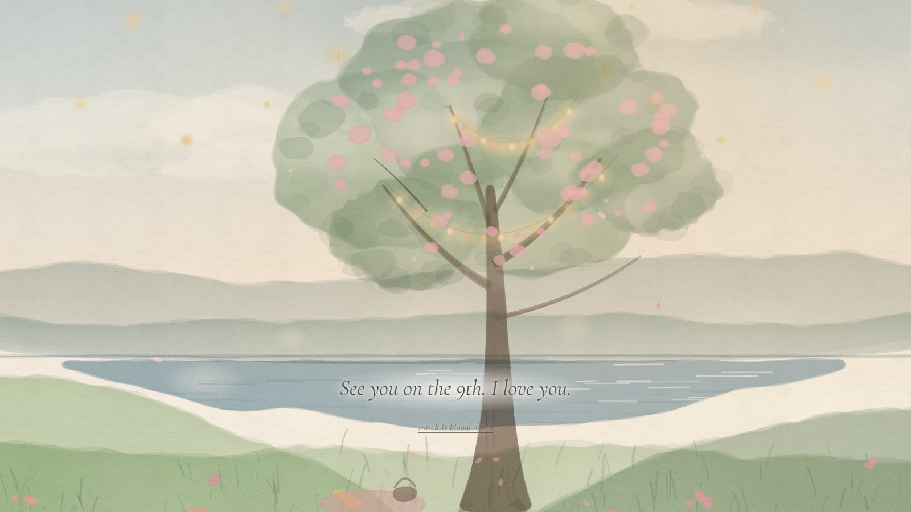
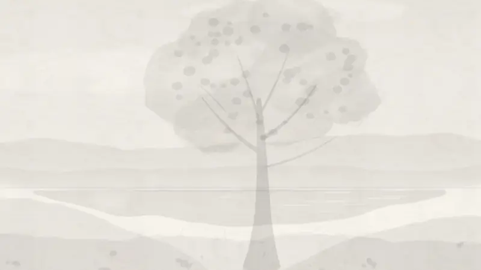
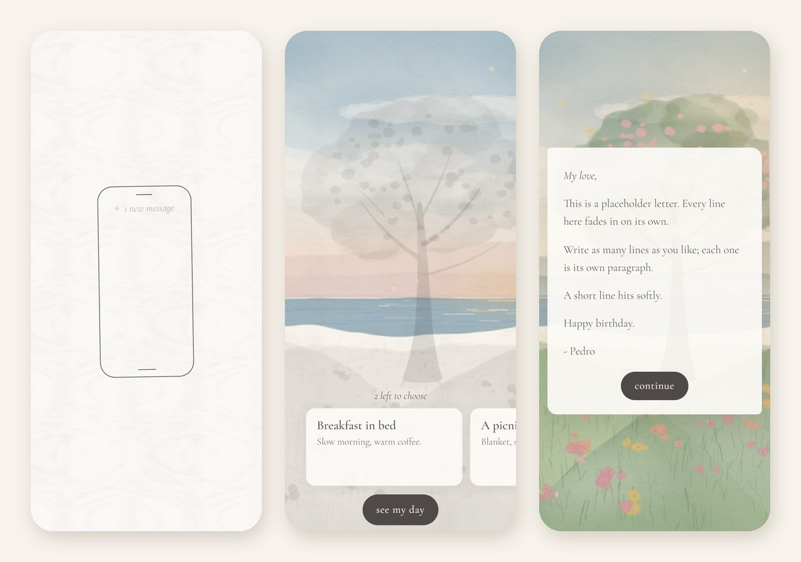

<div align="center">

# Cele's birthday garden

*A blank watercolor page that paints itself into a garden,<br>
one birthday wish at a time.*

**[Open the garden](https://jobberson.github.io/Bday-Website/)** · [Guide](docs/GUIDE.md)

<br>



</div>

<br>

## The idea

A birthday gift in the spirit of *GRIS*: the screen starts as empty paper. A phone
buzzes with a message, and she's invited to choose how she'd like to spend her birthday.
Every choice brings color back into the world, washing outward from where she tapped,
until the whole garden is in bloom. Then a letter, and her choices are sent as an email.

<div align="center">

</div>

## The experience

1. **Blank paper.** *Turn your sound on, then tap anywhere.*
2. **A phone buzzes.** It draws itself in ink; one new message.
3. **The message** arrives as chat bubbles, and the music begins.
4. **The choices.** A grey sketch of a garden appears behind the activity cards. Each pick
   paints part of the world in color and leaves its own trace: stars for stargazing,
   fairy lights for movie night, a blanket for the picnic.
5. **The final bloom.** Everything left fills with color as petals fall.
6. **A letter**, appearing line by line from blurred to sharp.
7. **Send.** Her picks arrive in your inbox.

<div align="center">

</div>

## Under the hood

No framework, no build step, no dependencies: plain HTML, CSS and JavaScript that runs
from GitHub Pages or straight from the folder.

- **Watercolor reveals on one canvas.** Each layer paints in through a low-resolution
  mask built from brush stamps that spread from a point, with a grey graphite sketch
  underneath. Layers that aren't moving are cached, so a frame is only a handful of draws.
- **Generated art.** The whole garden is painted by code at load: layered washes,
  pigment pooling at the edges, lifted highlights and paper granulation.
- **Alive, not busy.** The tree sways in uneven gusts, specks of light drift, and
  petals fall, all tuned to stay at full frame rate on mid-range phones.
- **Adaptive quality.** An invisible benchmark runs while the page loads and picks the
  best quality the device handles (iOS Low Power Mode's 30 fps cap is recognized as
  fine, not slow).
- **Never stuck loading.** Every file has a timeout and a fallback; the experience starts
  within 15 seconds no matter what.
- **Sound done carefully.** Web Audio fades (iOS ignores volume), gapless or crossfaded
  loops, playing through the iPhone's silent switch where supported, and pausing when she
  leaves the tab.
- **Respectful.** Honors *reduce motion* (soft fades, no wind or petals), works with a
  keyboard and screen readers, and handles notches, rotation and the mobile toolbar.
- **Everything in one file.** Words, activities, timing, colors, music and every layer's
  behavior live in [`config.js`](config.js).

## Make it yours

```bash
git clone https://github.com/Jobberson/Bday-Website.git
cd Bday-Website
python -m http.server 8765      # then open http://localhost:8765
```

1. Write your message, letter and activities in [`config.js`](config.js).
2. Add a free [Web3Forms](https://web3forms.com) key so the choices reach your inbox.
3. Push to GitHub and turn on **Settings → Pages**.

The [**Guide**](docs/GUIDE.md) covers everything else: every setting in `config.js`,
adding music and a photo, replacing the art, deploying, and the `?debug` panel for
testing each moment of the story.

<br>

<div align="center">
<sub>Made with love for Cele's birthday · November 9, 2026</sub>
</div>
